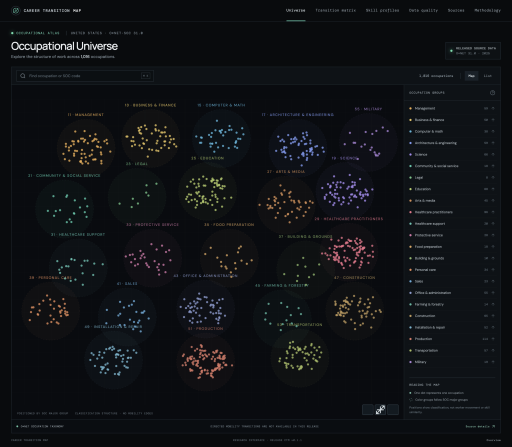
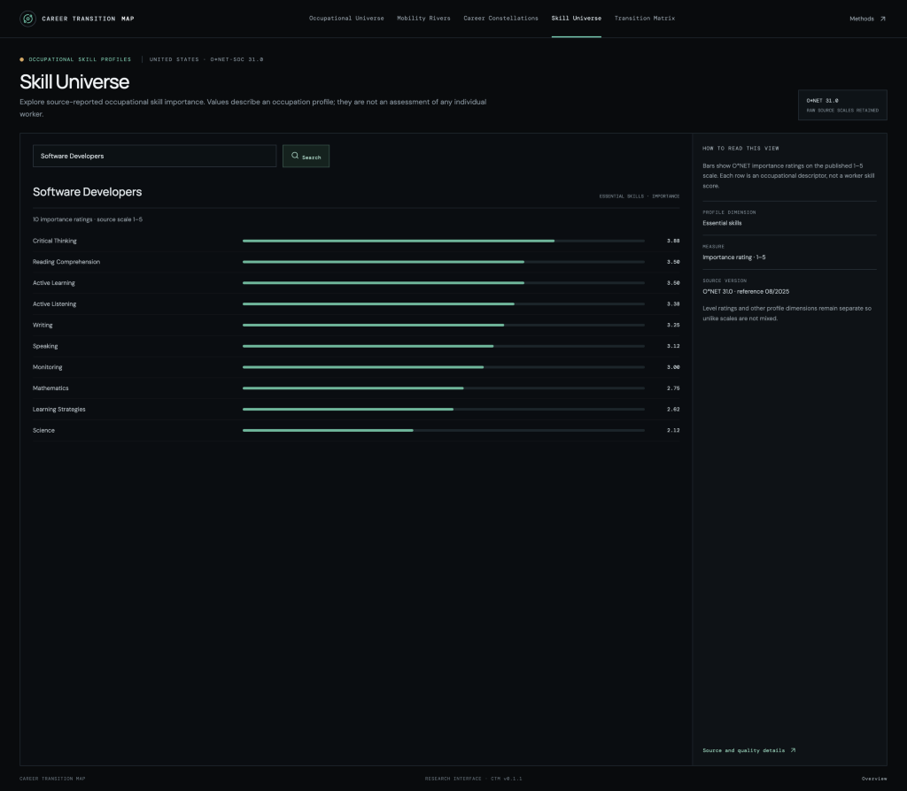
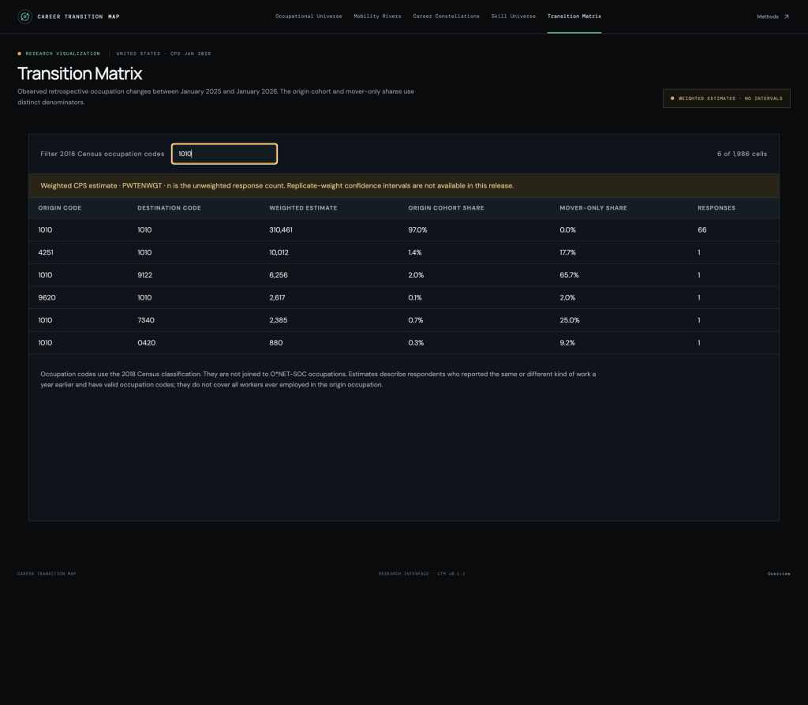
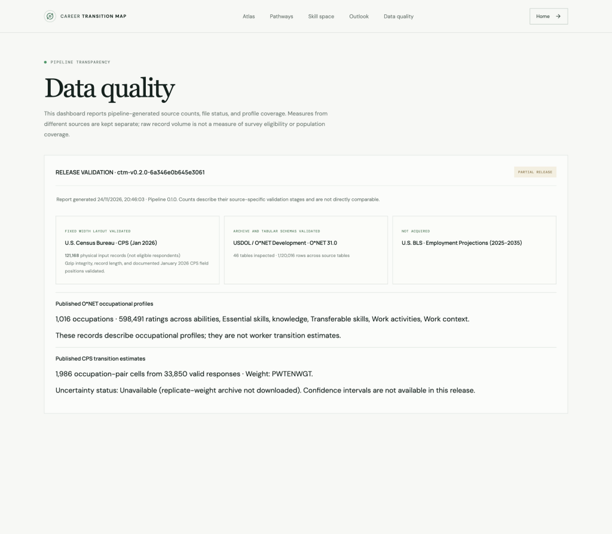
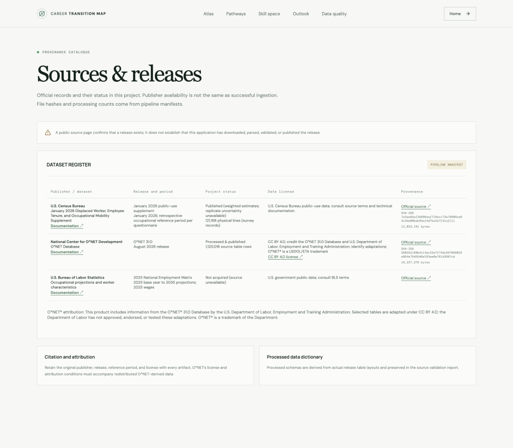

# Career Transition Map

**The invisible connections between careers.**

[](LICENSE)
[](pyproject.toml)
[](package.json)
[](https://www.onetcenter.org/)
[](https://www.census.gov/)

Career Transition Map is an open-source labor-market research observatory. It combines occupational profiles with observed worker mobility while keeping survey estimates, profile similarity, and employment projections methodologically distinct. It is designed as an exploratory research platform with explicit data provenance, not a black-box career recommendation engine.


_Interactive Occupational Universe showing 1,016 O\*NET 31.0 occupations clustered across 23 Standard Occupational Classification (SOC) major groups with live filtering and occupational detail cards._

---

## The Problem It Solves

Workforce mobility and career transitions are often represented through opaque recommendation models that conflate three fundamentally different concepts:

1. **Observed mobility**: How workers actually move between occupations based on empirical survey samples.
2. **Profile similarity**: How similar two occupations appear based on cataloged knowledge and skill descriptors.
3. **Employment outlook**: Long-range economic projections that model macroeconomic changes rather than current vacancies.

Career Transition Map enforces strict methodological boundaries:

- **Receipts first**: Every published metric cites its originating source, publication version, and reference period.
- **Distinct denominators**: Transition estimates document both origin-cohort denominators and mover-only denominators.
- **No synthetic fill**: When source files or linkage crosswalks are not yet verified, views remain explicitly marked as unavailable rather than displaying fabricated or synthetic approximations.

---

## Visual Showcase

### 1. Occupational Universe (`/atlas`)

Explore the structure of 1,016 occupations organized into 23 SOC major group clusters. Features real-time search across titles and SOC codes, interactive SVG canvas zooming, and dedicated occupation detail panels with links to skill profiles.


### 2. Skill Profiles & Importance Ratings (`/skills`)

Inspect pure source-reported O\*NET ratings on their published 1–5 scale. Visualizes essential skill importance rankings without collapsing dissimilar scales or implying individual worker evaluations.



### 3. Transition Matrix (`/matrix`)

Examine 1,986 weighted retrospective occupation transitions derived from the Current Population Survey (CPS). Filter by 2018 Census occupation codes to inspect weighted population estimates, origin cohort retention rates, mover-only shares, and unweighted survey response counts.



### 4. Release Validation & Data Quality (`/quality`)

Inspect automated pipeline validation results, record counts, file integrity checks, and uncertainty status across every ingested source dataset.



### 5. Dataset Register & Provenance (`/sources`)

Review the cryptographic SHA-256 provenance hashes, file sizes, official government download endpoints, and licensing details for all pipeline data sources.



---

## Current Release Scope

The current release (`ctm-v0.2.0`) includes:

- **O\*NET 31.0**: 1,016 occupational profiles and 598,491 descriptor ratings across essential skills, transferable skills, work activities, and work context.
- **CPS January 2026 Supplement**: 1,986 weighted occupation-pair transition cells from 33,850 eligible respondents using survey weights (`PWTENWGT`).

**Current release boundaries:**

- CPS replicate-weight archives have not yet been joined, so standard errors and confidence intervals are explicitly unavailable.
- CPS occupation codes remain in the 2018 Census classification and are not linked to O\*NET-SOC codes.
- BLS employment projections and wages, profile-similarity algorithms, mobility pathways, and graph network measures remain unpopulated pending verified source crosswalks.

See [data coverage and limitations](docs/limitations.md), [statistical methodology](docs/statistical-methodology.md), and [data pipeline guide](docs/data-pipeline.md) for full technical details.

---

## Requirements

- **Node.js**: `22.0.0` or newer
- **pnpm**: `10.6.3` (or via Corepack)
- **Python**: `3.12` or newer
- **uv**: Fast Python package and environment manager

Dependency versions are strictly locked in `pnpm-lock.yaml` and `uv.lock`.

---

## Quick Start

### 1. Install dependencies and initialize environment

```bash
# Clone the repository
git clone https://github.com/ranajahanzaib/career-transition-map.git
cd career-transition-map

# Install Python and Node dependencies
make setup

# Create local environment configuration
cp .env.example .env.local
```

### 2. Start development servers

Start the web application and API service in separate terminal sessions:

```bash
# Terminal 1: Web Application (Next.js)
make dev       # http://localhost:3000

# Terminal 2: API Service (FastAPI)
make api       # http://localhost:8000
```

Interactive OpenAPI documentation is available at `http://localhost:8000/api/docs`.

### Environment Configuration

Variables supported in `.env.local`:

| Variable                | Description                                      | Default                                  |
| :---------------------- | :----------------------------------------------- | :--------------------------------------- |
| `CTM_RELEASE_DIR`       | Filesystem path to published release directory   | `./data/releases/current`                |
| `CTM_CORS_ORIGINS`      | Permitted CORS origins for the API               | `http://localhost:3000`                  |
| `CTM_CORS_ORIGIN_REGEX` | Regular expression for local CORS matching       | `^http://(localhost\|127\.0\.0\.1):\d+$` |
| `NEXT_PUBLIC_API_URL`   | Base URL used by the web client to reach the API | `http://localhost:8000/api/v1`           |

---

## API Reference

The read-only API serves versioned, immutable research artifacts from the published release directory.

### Health and Metadata

```bash
# Health check and active release ID
curl -s http://localhost:8000/api/v1/health | jq .

# Published releases list
curl -s http://localhost:8000/api/v1/releases | jq .

# Release metadata and schema version
curl -s http://localhost:8000/api/v1/metadata | jq .
```

### Occupations and Skills

```bash
# Search occupations
curl -s "http://localhost:8000/api/v1/occupations?search=software&limit=5" | jq .

# Get specific occupation details
curl -s http://localhost:8000/api/v1/occupations/15-1252.00 | jq .

# Query O*NET essential skill profile
curl -s "http://localhost:8000/api/v1/occupations/15-1252.00/skills?dimension=essential_skills&limit=10" | jq .
```

### Transition Cells

```bash
# Filter transitions by origin Census occupation code
curl -s "http://localhost:8000/api/v1/transitions?origin=1010&limit=5" | jq .
```

### Validation and Sources

```bash
# Release quality and validation audit
curl -s http://localhost:8000/api/v1/quality | jq .

# Source registry with cryptographic hashes
curl -s http://localhost:8000/api/v1/sources | jq .
```

---

## Reproducible Data Pipeline

The data pipeline processes raw government surveys and databases into immutable Parquet and JSON research releases:

```bash
# Full rebuild sequence
make data-rebuild

# Or step-by-step:
make data-download   # Fetch official source archives
make data-validate   # Verify checksums and record layouts
make data-process    # Parse fixed-width surveys and extract tables
make data-estimate   # Compute weighted transition cells and shares
make data-publish    # Generate immutable release with atomic pointer
```

Published releases are stored under `data/releases/ctm-v<semver>-<hash>/`. The `data/releases/current` symlink is atomically updated only upon successful validation. Raw surveys and interim files stay excluded from Git.

---

## Testing & Verification

Run the complete test suite and type check:

```bash
# Run pytest and TypeScript verification
make test

# Or run individual checks:
UV_CACHE_DIR=.cache/uv uv run pytest -v
./node_modules/.bin/tsc --noEmit
UV_CACHE_DIR=.cache/uv uv run ruff check services/ scripts/ pipelines/ tests/
```

All 9 API, CPS parser, and transition estimation tests pass cleanly.

---

## Dashboard Views & Routes

- `/` (and `/atlas`) — Occupational Universe interactive map and O\*NET search
- `/matrix` — Weighted CPS occupation transition cells and filter
- `/skills` — Occupational skill profiles and source importance ratings
- `/quality` — Pipeline validation report and record audits
- `/sources` — Source register, provenance hashes, and licenses
- `/methodology` — Research measures, classifications, and statistical rules

---

## Project Documentation

- [Architecture Overview](docs/architecture.md)
- [Data Dictionary](docs/data-dictionary.md)
- [Data Pipeline Guide](docs/data-pipeline.md)
- [Data Update Guide](docs/data-update-guide.md)
- [Deployment Guide](docs/deployment.md)
- [Limitations & Scope](docs/limitations.md)
- [Network Methodology](docs/network-methodology.md)
- [Occupation Crosswalks](docs/occupation-crosswalks.md)
- [Skill Modeling](docs/skill-modeling.md)
- [Statistical Methodology](docs/statistical-methodology.md)
- [Visualization System](docs/visualization-system.md)

---

## Contributing

See [CONTRIBUTING.md](CONTRIBUTING.md) for development workflows, testing guidelines, and review expectations. All changes to parsers, estimation logic, or API schemas must include accompanying test coverage.

---

## Data Attribution

- **O\*NET® Database**: This product includes information from the [O\*NET® 31.0 Database](https://www.onetcenter.org/database.html) by the U.S. Department of Labor, Employment and Training Administration, used under the [Creative Commons Attribution 4.0 International License](https://creativecommons.org/licenses/by/4.0/). O\*NET® is a trademark of the U.S. Department of Labor, Employment and Training Administration. Adaptations select occupation and profile fields and convert source tables to Parquet and JSON while preserving the original rating scales. The Department of Labor has not approved, endorsed, or tested these modifications.
- **Current Population Survey (CPS)**: U.S. Census Bureau public-use data. January 2026 Displaced Worker, Employee Tenure, and Occupational Mobility Supplement.
- **Independence**: Career Transition Map is an independent open-source project and is not endorsed by the U.S. Census Bureau, the Bureau of Labor Statistics, or the U.S. Department of Labor.

## License & Custom Work

[](mailto:work@withrana.com) [](https://www.linkedin.com/in/workwithrana)
[](https://www.upwork.com/freelancers/~01bbcf6edb91a8df5f)
[](https://contra.com/ranajahanzaib/)

**License:** MIT, see [LICENSE](LICENSE). Free for personal, academic, and commercial use. Source datasets remain subject to their respective publishers' terms.

**Author:** Rana Jahanzaib

**Need this built for your stack?** Email me what you're working on: work@withrana.com
